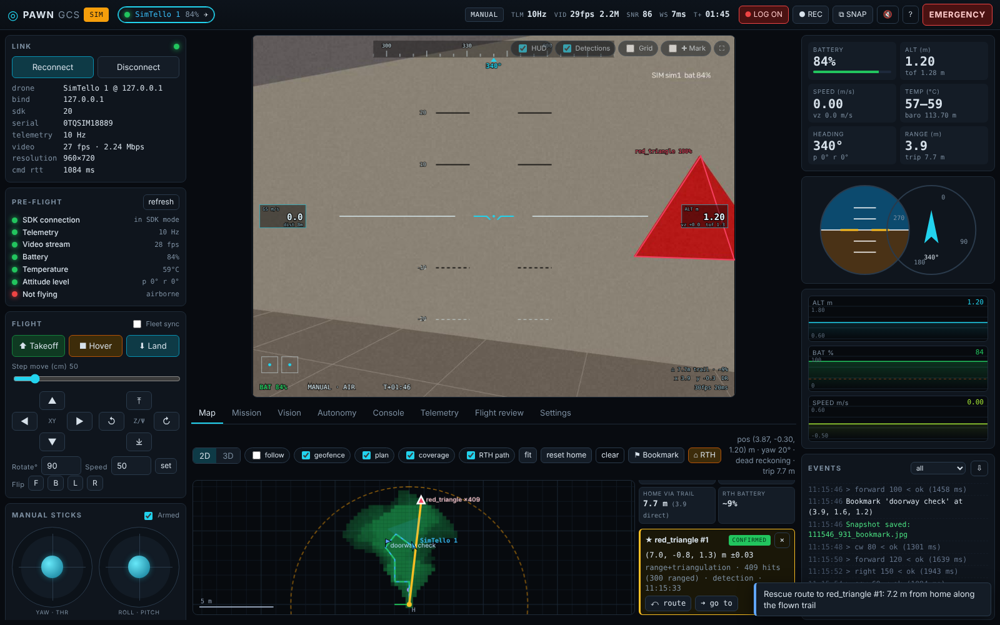

# PAWN Ground Control Station

Web-based ground control station for the **DJI Tello**, built for **PAWN — Photogrammetric Autonomous Workspace Navigator** (Bilkent CS491). One Python process talks to the drone(s) over UDP and serves a browser UI, so it runs the same on **Windows, macOS and Linux** (and a tablet/phone can join over the network).



## Features

| Area | What you get |
|---|---|
| **Live video** | H.264 → PyAV decode, ~30 fps JPEG stream to the browser, fullscreen, grid, glass-to-glass latency readout |
| **HUD** | Artificial horizon + pitch ladder, heading tape, speed / altitude / vertical-speed boxes, battery, mode, flight time, stick indicators, blinking warnings, REC indicator, detection overlays |
| **Flight control** | Connect / takeoff / land / hover / **emergency**, step moves, rotate, flips, speed; **keyboard** (WASD + arrows), **gamepad** (Mode 2, expo/deadzone), **touch sticks**; dead-man on the server zeroes sticks if input stops |
| **Telemetry** | All 16 Tello state fields, 10 Hz charts (alt, ToF, speed, vz, battery, temp), attitude indicator + compass, Wi-Fi SNR, link rates, command RTT |
| **Safety** | Pre-flight checklist (blocks takeoff), low-battery warn → **auto-land**, over-temp warning, telemetry-loss detection, **geofence** (radius + ceiling → hover/land), client-loss failsafe, pilot override of MISSION/AUTO |
| **Missions** | Visual step editor (move/rotate/go/speed/flip/wait/hover/snapshot/record/**scan**/**wait-for-detection**/raw), kinematic preview with distance/time/geofence check, save/load/import/export JSON, run/pause/resume/abort with live progress |
| **Map** | 2D top-down and **3D orbit** view, trajectories of every drone, camera FOV wedge, geofence, mission plan, **target markers with bearing**, SLAM point clouds |
| **Vision plugins** | Red triangle (PAWN target), ArUco (+range), person (HOG), faces, tunable color blob, **moving-obstacle optical flow**, **frame quality for photogrammetry**, YOLO (optional) — drop-in Python plugins with auto-generated parameter forms |
| **Autonomy** | Controller plugins that output rc sticks in AUTO mode: visual-servo target tracking (IBVS), search-spin-then-track, altitude hold example — PAWN's algorithms plug in here |
| **Logging & review** | Auto flight log on takeoff: telemetry CSV, events/commands/detections JSONL, MP4 video, snapshots. **Flight review** tab replays trajectory + charts + video in sync |
| **Multi-drone** | Fleet selector, **fleet sync** (tandem takeoff/land/moves/missions), per-drone bind IP for two normal Tellos on two Wi-Fi adapters, shared map frame |
| **Target localisation (v2)** | Detections become **3D map positions**: bearing-ray triangulation from several viewpoints fused with known-size ranging (red triangle, person) in one least-squares solve, data association, 1σ uncertainty circles, tentative → **confirmed**; operator **✚ Mark** on the video triangulates too |
| **Backtracking & RTH (v2)** | **Rescue route** per target (where it was first seen → flown trail → home), **RTH along the breadcrumb trail** (never straight through a wall), go-to-target, **smart RTH battery** with an in-flight learned drain rate |
| **SAR tools (v2)** | **Coverage heat map** of what the camera has swept + explored m², **IAMSAR search patterns** (expanding square, parallel track, sector, orbit, 360° scan grid) as editable missions, bookmarks, SAR summary panel |
| **Collision guard (v2)** | Monocular **time-to-contact** (looming, LK corner tracking) → automatic brake (`stop` + hover) when flying at an obstacle; optional brake for moving obstacles |
| **3D twin dataset (v2)** | Every flight log keeps sharp, well-spaced keyframes + poses → **`transforms.json` (nerfstudio / Gaussian splatting) + COLMAP model**, one-click zip |
| **Reports & UX (v2)** | Printable **post-flight report** (HTML → PDF), session zip export, **voice call-outs** (EN/TR), gamepad / **RC transmitter axis learning** (EdgeTX USB joystick), installable PWA for tablets |
| **Simulator** | Built-in software-in-the-loop Tello: real UDP protocol, physics, battery, synthetic 3D indoor FPV video with textured walls and targets — develop everything without a drone |
| **Integration** | REST + WebSocket API (OpenAPI docs at `/docs`), raw H.264 UDP relay for SLAM/ROS nodes, external pose / point-cloud / marker endpoints, SDK console |

## Quick start

Requires **Python 3.9+** (the Python that ships with macOS Command Line Tools works).

```bash
# Linux / macOS
./start.sh --sim          # simulator (no drone needed)
./start.sh                # real Tello: join the TELLO-XXXX Wi-Fi first

# Windows
start-sim.bat             # simulator
start.bat                 # real Tello
```

The launcher creates `.venv`, installs `requirements.txt` once, starts the server and opens **http://127.0.0.1:8080**.

Manual: `pip install -r requirements.txt` then `python -m pawn_gcs [--sim [N]] [--host 0.0.0.0] [--port 8080]`.
`--sim 2` starts two simulated drones for tandem testing.

> **Firewall:** the Tello sends telemetry to UDP **8890** and video to UDP **11111** on your PC. Allow Python on the private network (Windows asks on first start). See [docs/TELLO_NETWORK.md](docs/TELLO_NETWORK.md).

## Türkçe hızlı başlangıç

1. Python 3.9+ kurulu olsun (Mac'teki hazır Python 3.9 yeter) (ya da Python'suz: GitHub Releases'teki hazır **PAWN-GCS** paketini indir — Windows / macOS / Linux).
2. Drone olmadan denemek için: Windows'ta `start-sim.bat`, macOS/Linux'ta `./start.sh --sim`.
3. Gerçek Tello: bilgisayarı `TELLO-XXXX` Wi-Fi ağına bağla → `start.bat` / `./start.sh` → tarayıcıda **Connect**.
4. Klavye: `T` kalkış, `L` iniş, `Space` hover, `Shift+Space` **acil motor durdurma**, WASD + ok tuşları manuel uçuş, `?` tüm kısayollar.
5. Kendi tespit algoritmanı eklemek için `plugins/example_plugins.py`'yi kopyala (bkz. [docs/PLUGINS.md](docs/PLUGINS.md)); SLAM entegrasyonu için `examples/slam_bridge.py`.

### Arama-kurtarma akışı (v2)

1. **Vision** sekmesinde `red_triangle` (veya `person_hog` / `yolo`) ve `collision_ttc`'yi aç.
2. **Mission → Search pattern generator** ile bir arama deseni üret (ör. *expanding square*), önizle, **Run** — ya da elle uç.
3. Tespitler haritada önce `tentative` (?) olarak görünür; farklı noktalardan görüldükçe **triangüle edilir** ve `CONFIRMED` olur (sesli uyarı, kesikli çember = 1σ belirsizlik).
4. Pilot bir kazazede görürse `K` (✚ Mark) → videoda tıkla; yana kayıp tekrar tıkla → konumu hesaplanır.
5. Haritada hedefe tıkla → **route**: hedefin ilk görüldüğü yerden uçulan iz boyunca eve giden **kurtarma rotası**.
6. **⌂ RTH** (`Shift+H`): drone uçtuğu iz üzerinden geri döner ve iner. *Smart RTH* bataryanın dönüşe yetmeyeceği anı önceden söyler.
7. İnişten sonra **Flight review** → 📄 rapor, ⇩ oturum zip, ⇩ **3D dataset** (nerfstudio / COLMAP ile dijital ikiz).

Algoritmaların ayrıntısı: [docs/SAR.md](docs/SAR.md).

## Project layout

```
pawn_gcs/
  core/        tello.py (UDP link)  video.py (H.264)  node.py (per-drone control & arbitration)
               safety.py  mission.py  odometry.py  recorder.py  mapstore.py  bus.py
  vision/      plugin API + manager, plugins/builtin.py
  autonomy/    controller API + built-in controllers
  core/        ... targets.py (3D localisation)  navigation.py (backtrack/RTH)  coverage.py  patterns.py
               keyframes.py (3D dataset)  report.py  geometry.py (camera model, RDP)
  sim/         Tello emulator + synthetic camera renderer
  web/         UI (vanilla ES modules, no build step, no CDN - works offline on the Tello Wi-Fi)
  server.py    FastAPI REST + WebSocket     app.py  wiring     config.py
plugins/       your vision plugins & controllers (auto-loaded)
missions/      mission JSON files
examples/      api_client.py, slam_bridge.py
docs/          SAR.md (v2 algorithms), ARCHITECTURE.md, PLUGINS.md, API.md, TELLO_NETWORK.md
packaging/     PyInstaller spec + build.py (standalone app per OS), .github/workflows/release.yml
tests/         unit + end-to-end tests against the simulator
```

## Who works where (PAWN team)

| Role | Entry point |
|---|---|
| Drone I/O | `core/tello.py`, `core/node.py` (link, rc arbitration, keep-alive), `config.toml` |
| Detection | `plugins/*.py` (VisionPlugin), `vision/plugins/builtin.py` |
| GUI | `web/` (`js/tabs/*` one file per tab, `css/app.css`) |
| SLAM / mapping | `examples/slam_bridge.py` → `POST /api/drones/{id}/pose`, `/api/map/clouds/{name}`, `/api/map/markers`; raw video via `video.relay_udp` |
| Autonomy | `autonomy/__init__.py` (Controller), `plugins/*.py` |
| Search & rescue logic | `core/targets.py`, `core/navigation.py`, `core/coverage.py`, `core/patterns.py`, `core/keyframes.py` — see [docs/SAR.md](docs/SAR.md) |

## Standalone app (no Python on the field laptop)

```bash
pip install -r requirements.txt pyinstaller
python packaging/build.py        # -> dist/PAWN-GCS/ and dist/PAWN-GCS-<os>-<arch>.zip
```
Build once per OS (PyInstaller does not cross-compile) — or push a `v*` tag and the **release** workflow builds
Windows, macOS and Linux bundles, smoke-tests each with the simulator and attaches them to a GitHub release.
`config.toml`, `missions/` and `plugins/` sit next to the executable and stay editable.

## Tests

```bash
pip install pytest httpx
python -m pytest            # 43 tests: protocol, missions, odometry, settings, localisation, patterns, coverage,
                            # dataset export + end-to-end sim flights (search -> confirm target -> RTH -> report,
                            # collision guard stopping before a wall)
```

## Notes & limits

* Normal Tellos speak SDK 1.3/2.0 (firmware dependent): `stop`, `setbitrate`, `setfps`, `setresolution` need newer firmware; mission pads (`mon`, `mid`) are **EDU only**.
* Dead-reckoning (vgx/vgy integration) drifts; it is for the live map and geofence. Feed a SLAM pose to `/api/drones/{id}/pose` for real positioning. Check `odometry.velocity_scale_cm` / `velocity_frame` against your firmware with a measured flight.
* Target positions are triangulated from detection rays (+ known-size ranging) using the GCS pose; their accuracy follows the pose accuracy. With pure dead reckoning expect decimetres to a metre; a SLAM pose improves it directly.
* The coverage map has no occlusion test and the collision guard needs texture (blank walls, glass and thin wires are hard for any monocular method) — both are aids for the pilot, not guarantees.
* `face` uses Haar cascades which are not in OpenCV 5 builds — use OpenCV 4.8–4.x or YOLO.
